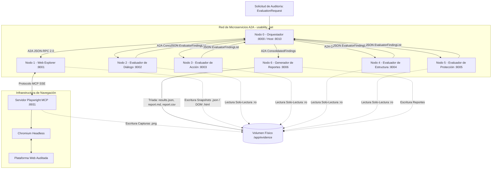

# DIMA-HE: Sistema Multiagente Distribuido para la Evaluación Heurística de Interfaces Web

[](https://github.com/DaveCuc/dima-he/actions)
[](https://www.python.org/downloads/)
[](https://github.com/google/adk)
[-orange.svg)](https://a2a-protocol.org/)
[-blueviolet.svg)](https://modelcontextprotocol.io/)
[](https://www.docker.com/)

**DIMA-HE** (*Distributed Multi-Agent Heuristic Evaluator*) es un sistema multiagente distribuido y multimodal diseñado para la auditoría y diagnóstico automatizado de interfaces web aplicando de forma sistemática y científicamente reproducible las **10 heurísticas de usabilidad de Jakob Nielsen**.

El sistema fue concebido y validado como herramienta de investigación para la evaluación heurística integral de la plataforma web de la **Reserva de la Biosfera Tehuacán-Cuicatlán**, permitiendo comparar cuantitativamente la versión original (*pre-rediseño*) frente a la versión optimizada (*post-rediseño*).

---

## 🏛️ Arquitectura del Sistema

La arquitectura está conformada por **7 Nodos de Agentes A2A independientes**, un **Servicio de Infraestructura Playwright MCP** y un **Volumen Físico de Evidencias** compartido (`/app/evidence`).



### Distribución de Responsabilidades por Nodo

| Nodo | Rol | Puerto | Heurísticas / Función | Acceso a Evidencia |
| :--- | :--- | :---: | :--- | :---: |
| **Nodo 0: Orquestador** | Coordinador | `8010:8000` | Ciclo `LoopAgent` con `EscalationChecker`, `ParallelAgent`, `DeduplicatorAgent` y cadena secuencial `root_agent`. | Lectura/Escritura |
| **Nodo 1: Web Explorer** | Explorador | `8001` | Automatización Chromium vía Playwright MCP, captura de viewport, árbol de accesibilidad y DOM. | Lectura/Escritura |
| **Nodo 2: Evaluador Diálogo** | Evaluador | `8002` | **H1** (Visibilidad del estado), **H2** (Coincidencia con mundo real), **H10** (Ayuda y documentación). | Solo Lectura (`:ro`) |
| **Nodo 3: Evaluador Acción** | Evaluador | `8003` | **H3** (Control y libertad del usuario), **H7** (Flexibilidad y eficiencia). | Solo Lectura (`:ro`) |
| **Nodo 4: Evaluador Estructura** | Evaluador | `8004` | **H4** (Consistencia y estándares), **H6** (Reconocimiento antes que recuerdo), **H8** (Diseño estético y minimalista). | Solo Lectura (`:ro`) |
| **Nodo 5: Evaluador Protección** | Evaluador | `8005` | **H5** (Prevención de errores), **H9** (Reconocer y recuperarse de errores). | Solo Lectura (`:ro`) |
| **Nodo 6: Generador Reportes** | Reportero | `8006` | Cálculo estadístico cuantitativo y generación de tríada: `results.json`, `report.md` y `report.csv`. | Lectura/Escritura |
| **Infraestructura: Playwright** | Servidor MCP | `8931` | Chromium Headless en contenedor con SSE y memoria compartida optimizada (`1gb`). | Lectura/Escritura |

---

## 🚀 Características Principales

1. **Protocolo Agent2Agent (A2A) Nativo:** Comunicación HTTP JSON-RPC 2.0 y descubrimiento dinámico mediante `/.well-known/agent-card.json`.
2. **Model Context Protocol (MCP) Aislado:** Conexión exclusiva entre el explorador y el navegador sin intermediarios.
3. **Evidencias Físicas Reales:** Persistencia física en disco de capturas `.png`, árboles de accesibilidad `.json` y volcados `.html`. **Prohibición estricta de Base64** en cargas útiles de red.
4. **Patrones Google ADK en Python Puro:**
   * **EscalationChecker (`EvidenceValidatorAgent`):** Verificación física determinista en disco que rompe el bucle de exploración solo cuando la evidencia es íntegra.
   * **DeduplicatorAgent:** Agrupación determinista de problemas duplicados reportados por múltiples evaluadores, preservando la máxima severidad y la trazabilidad de origen (`source_agents` y `original_finding_ids`).
5. **Motor de Evaluación Dual:**
   * Inferencia multimodal avanzada con **Gemini API** (`google-genai`) inyectando bytes de imagen (`Part.from_bytes`).
   * Motor determinista de respaldo sin dependencias externas para pruebas continuas en CI/CD.
6. **Tríada Oficial de Reportes:**
   * `results.json`: Datos estructurados completos para consumo programático y APIs.
   * `report.md`: Tablas y resúmenes ejecutivos listos para incorporar en el documento de tesis.
   * `report.csv`: Dataset tabular en formato RFC 4180 (`csv.QUOTE_ALL`) para análisis estadístico.
7. **Seguridad Anti-SSRF:** Lista blanca estricta (`ALLOWED_TARGET_HOSTS`) y exploración no destructiva de solo lectura.

---

## 🛠️ Instalación y Despliegue Rápido

### Prerrequisitos
* Docker y Docker Compose v2+.
* Python 3.12+ (para desarrollo local).

### 1. Clonar el Repositorio y Configurar Entorno
```bash
git clone https://github.com/DaveCuc/dima-he.git
cd dima-he
cp .env.example .env
```

Edita `.env` si deseas configurar tu clave de Gemini API (`GOOGLE_API_KEY`) para inferencia multimodal en vivo (opcional; el sistema opera en modo determinista en su ausencia).

### 2. Despliegue con Docker Compose
```bash
docker compose up -d --build
```

Comprueba el estado saludable de los 8 contenedores:
```bash
docker compose ps
```

### 3. Ejecutar una Auditoría Heurística
```bash
curl -X POST http://localhost:8010/evaluate?full_pipeline=true \
  -H "Content-Type: application/json" \
  -d '{
    "evaluation_id": "eval-demo-001",
    "target_url": "http://host.docker.internal:8000",
    "scope": {"max_depth": 1},
    "instructions": "Auditoría heurística completa de la plataforma."
  }'
```

Los resultados quedarán disponibles inmediatamente en:
`evidence/evaluations/eval-demo-001/reports/`

---

## 🧪 Suite de Pruebas Automatizadas

El proyecto cuenta con una cobertura integral que abarca pruebas unitarias, de contrato A2A, de integración de componentes y de extremo a extremo (E2E):

```bash
# Ejecutar la suite completa (90 pruebas)
pytest -v --tb=short
```

Estado de la suite de pruebas:
* **Pruebas Unitarias:** 48 pruebas (esquemas Pydantic v2, utilidades, deduplicador, generador de reportes, docker-compose).
* **Pruebas de Contrato A2A:** 15 pruebas (agent-cards, endpoints JSON-RPC 2.0 y validaciones de esquema).
* **Pruebas de Integración:** 25 pruebas (Playwright MCP, Web Explorer, LoopAgent con EscalationChecker, ParallelAgent, Full Pipeline).
* **Pruebas de Extremo a Extremo (E2E):** 2 pruebas (ciclo de auditoría completo y comparación cuantitativa pre vs. post rediseño).

---

## 📚 Documentación Técnica

* 📄 **[Arquitectura Detallada](docs/architecture.md):** Especificación técnica de componentes, flujos y protocolos.
* 🚀 **[Guía de Despliegue](docs/deployment.md):** Manual operativo, variables de entorno y monitoreo.
* ⚖️ **[Decisiones de Diseño (ADRs)](docs/decisions.md):** Justificación técnica de las 8 decisiones arquitectónicas clave.
* 🔒 **[Política de Seguridad](SECURITY.md):** Reglas anti-SSRF, restricciones de navegación y gestión de secretos.

---

## 📄 Licencia

Este proyecto está bajo la Licencia MIT. Consulta el archivo [LICENSE](LICENSE) para más detalles.
