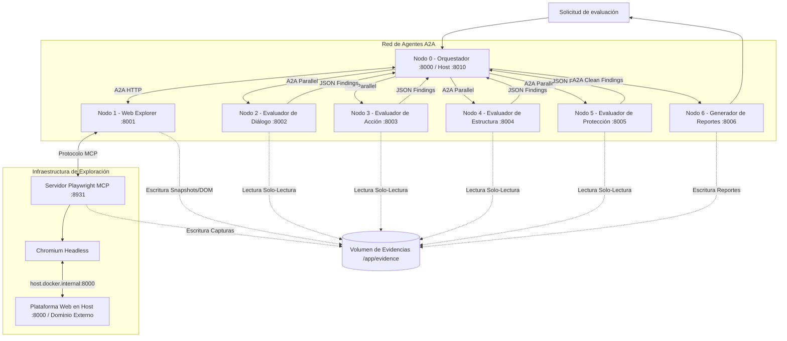

# BLUEPRINT TÉCNICO v2.0
## Sistema multiagente distribuido para la evaluación heurística de interfaces web
* **Versión:** 2.0 (Consolidada con patrones Google ADK, A2A y Playwright MCP)
* **Tipo de documento:** Especificación técnica para desarrollo asistido por IA
* **Agente desarrollador:** Antigravity u otro agente de programación autónomo
* **Arquitectura:** Multiagente distribuida con protocolo A2A y herramientas MCP
* **Entorno inicial:** Host Windows 11 con despliegue en Linux mediante Docker Compose
* **Caso de uso:** Evaluación heurística de usabilidad de la plataforma web de la Reserva de la Biosfera Tehuacán-Cuicatlán.

---

## 1. Instrucciones generales para el agente desarrollador
Actúa como arquitecto de software y desarrollador especializado en Python, Google Agent Development Kit (ADK), Agent2Agent (A2A), Model Context Protocol (MCP), Playwright y Docker.
Tu objetivo es implementar un sistema multiagente distribuido para explorar y evaluar interfaces web mediante las 10 heurísticas de usabilidad de Jakob Nielsen. Debes desarrollar el proyecto respetando estrictamente estas condiciones:
1. Conserva la arquitectura de siete nodos A2A más un contenedor de infraestructura MCP descrita en este documento.
2. No sustituyas tecnologías ni introduzcas frameworks alternativos sin justificación técnica y autorización previa.
3. Utiliza Google ADK (`SequentialAgent`, `LoopAgent`, `ParallelAgent`, `BaseAgent`, `Agent`, `RemoteA2aAgent`) para implementar y coordinar los agentes.
4. Utiliza el protocolo A2A para toda comunicación inter-agente entre los siete nodos.
5. Utiliza MCP (`McpToolset`) exclusivamente para conectar el Nodo 1 (Web Explorer) con el servidor de navegador.
6. Utiliza Microsoft Playwright MCP (`mcr.microsoft.com/playwright/mcp`) como servidor de herramientas de automatización sobre Chromium.
7. Utiliza Gemini API (`google-genai`) como proveedor del modelo multimodal.
8. Mantén las carpetas de los cuatro agentes evaluadores separadas (`evaluators/dialogue`, `action`, `structure`, `protection`) para permitir la futura inyección modular de sus respectivos Context Harnesses.
9. **Regla principal:** Antes de escribir código, inspecciona el repositorio existente. Identifica componentes implementados, dependencias y estado actual. Conserva el código funcional y modifica únicamente lo necesario. Si el repositorio está vacío, construye la estructura propuesta desde la Fase 0. No simules integraciones; cada conexión entre servicios debe verificarse con pruebas reales.

---

## 2. Objetivo del sistema
Desarrollar un sistema multiagente multimodal capaz de explorar una plataforma web, recopilar información estructural y visual verificable, identificar problemas de usabilidad y generar reportes estructurados fundamentados en las 10 heurísticas de Nielsen.
El sistema debe permitir auditar una misma interfaz en ejecuciones independientes (ej. versión anterior al rediseño `pre_redesign` y versión posterior `post_redesign`) siguiendo rutas e instrucciones deterministas para contrastar la cantidad y severidad de los hallazgos obtenidos en cada versión.

El sistema no debe limitarse a analizar capturas de pantalla. Debe combinar:
* Capturas visuales de pantalla (`screenshots`).
* Árbol de accesibilidad de la interfaz (`accessibility_snapshot`).
* Consultas puntuales al DOM (`dom`).
* Textos, microcopy y contenido visible.
* Registro secuencial de acciones ejecutadas y respuestas de componentes interactivos (`interaction_log`).

---

## 3. Arquitectura general
La solución está conformada por siete nodos de agentes independientes (Nodos 0 al 6) comunicados mediante el protocolo A2A, un servicio de infraestructura de navegación (Playwright MCP + Chromium) y un almacenamiento compartido de evidencias.

### 3.1. Diagrama de arquitectura


### 3.2. Tecnologías obligatorias
* **Python 3.11+:** Lenguaje base de todos los nodos.
* **Google ADK (`google-adk`):** Implementación de agentes y flujos (`SequentialAgent`, `LoopAgent`, `ParallelAgent`, `BaseAgent`).
* **Protocolo A2A (`a2a`):** Descubrimiento (`agent-card.json`) y comunicación HTTP entre los 7 nodos.
* **Protocolo MCP (`McpToolset`):** Conexión entre el Nodo 1 y el servidor de automatización del navegador.
* **Microsoft Playwright MCP:** Servidor oficial MCP (`mcr.microsoft.com/playwright/mcp`) para control de navegador.
* **Chromium:** Motor de renderizado y navegación web headless.
* **Gemini API (`google-genai`):** Inferencia multimodal de los Nodos 1 al 6.
* **Pydantic v2:** Contratos estrictos de entrada/salida (`output_schema`) y validación.
* **FastAPI / Uvicorn / HTTPX:** Exposición de servidores A2A y cliente HTTP asíncrono.
* **Docker & Docker Compose:** Aislamiento de nodos, red virtual y volumen compartido.

*Restricción:* No agregar bases de datos externas, Redis, brokers de colas ni Kubernetes.

---

## 4. Especificación técnica de los siete nodos y servicios

### 4.1. Nodo 0: Orquestador
* **Puerto interno:** 8000 (Mapeado al host como `8010:8000`).
* **Tecnología:** Python + Google ADK + A2A (No consume LLM directamente; opera con agentes organizadores y deterministas).
* **Componentes internos (Alineados al patrón Google ADK):**
  * `exploration_loop` (`LoopAgent`): Ciclo de extracción con `max_iterations=3`. Sub-agentes: `[remote_web_explorer, evidence_validator_agent]`.
  * `evidence_validator_agent` (`BaseAgent` — Python puro): Sigue el patrón `EscalationChecker` de Google ADK. Verifica físicamente en `/app/evidence` capturas y snapshots. Emite `EventActions(escalate=True)` si es válido; si falla, escribe en `exploration_feedback` para reintentar.
  * `parallel_evaluators` (`ParallelAgent`): Ejecuta concurrentemente llamadas A2A hacia `[remote_dialogue, remote_action, remote_structure, remote_protection]`. Almacena con `after_agent_callback` en `ctx.session.state`.
  * `deduplicator_agent` (`BaseAgent` — Python puro): Consolidación y limpieza determinista. Elimina duplicados exactos y agrupa diagnósticos complementarios preservando `source_agents` y `original_finding_ids`.
  * `root_agent` (`SequentialAgent`): Cadena principal: `[exploration_loop, parallel_evaluators, deduplicator_agent, remote_report_creator]`.
  * **Propagación explícita:** Empaquetar y enviar explícitamente en payloads A2A los datos de sesión.

### 4.2. Nodo 1: Web Explorer
* **Puerto:** 8001
* **Tecnología:** Python + Google ADK + Gemini API + McpToolset + A2A.
* **Responsabilidad:** Único agente con acceso al navegador a través de MCP. Recibe el alcance de exploración desde el Nodo 0, navega la plataforma, ejecuta acciones seguras, recopila capturas, snapshots de accesibilidad y datos del DOM, los persiste en `/app/evidence` y devuelve el contrato `ExplorationResult` por A2A.
* **Estrategia de Navegación y Alcance:**
  * Rutas públicas prioritarias (catálogos, módulos informativos y turísticos).
  * Autenticación parametrizada: inyección de credenciales de prueba al inicio de sesión si se solicitan flujos privados.
  * Límites estrictos de espera (Timeouts): máximo 30 segundos para carga inicial de página y 60 segundos para interacciones complejas (modales, menús o componentes dinámicos de Inertia.js).
  * Profundidad controlada: lista fija de URLs base con descubrimiento autónomo restringido a profundidad máxima de 1 nivel (`max_depth = 1`) para enlaces hijos directos.

### 4.3. Servicio Playwright MCP (Infraestructura)
* **Puerto interno:** 8931 (No exponer en host).
* **Imagen:** `mcr.microsoft.com/playwright/mcp`.
* **Configuración crítica:** Montar `/app/evidence`, `extra_hosts: ["host.docker.internal:host-gateway"]`, `shm_size: "1gb"`.

### 4.4. Nodos 2, 3, 4 y 5: Evaluadores Heurísticos
Carpetas independientes en `evaluators/dialogue`, `action`, `structure`, `protection`.
* `output_schema=EvaluatorFindingList`, `disallow_transfer_to_parent=True`, `disallow_transfer_to_peers=True`.
* Inyección multimodal vía `Part.from_bytes` leyendo rutas desde `/app/evidence`.
* **Distribución de heurísticas (`config/heuristics.yaml`):**
  * **Nodo 2 (Diálogo - :8002):** H1, H2, H10.
  * **Nodo 3 (Acción - :8003):** H3, H7.
  * **Nodo 4 (Estructura - :8004):** H4, H6, H8.
  * **Nodo 5 (Protección - :8005):** H5, H9.

### 4.5. Nodo 6: Report Creator
* **Puerto:** 8006
* **Tecnología:** Python + Google ADK + Gemini API + A2A.
* **Responsabilidades:** Recibe hallazgos consolidados, genera tablas por categoría, heurística y severidad (0-4), emite veredicto y guarda en `/app/evidence/evaluations/{evaluation_id}/reports/`:
  * `results.json`: Datos estructurados completos para consumo programático.
  * `report.md`: Resumen ejecutivo y tablas formateadas para insertar directamente en el documento de tesis.
  * `report.csv`: Datos tabulares limpios para análisis estadístico cuantitativo.

---

## 5. Modelo de datos y contratos Pydantic v2 (`shared/schemas/`)
* `evaluation.py`: `ViewportConfig`, `EvaluationScope`, `EvaluationRequest`.
* `evidence.py` y `exploration.py`: `EvidenceItem`, `PageExplorationResult`.
* `finding.py`: `FindingLocation`, `UsabilityFinding`, `EvaluatorFindingList`.

---

## 6. Estructura de Directorios
```plaintext
usability-multiagent/
├── docker-compose.yml
├── .env.example
├── .gitignore
├── README.md
├── pyproject.toml
├── blueprint.md
├── gemini.md
├── config/
│   ├── agents.yaml
│   ├── evaluation.yaml
│   └── heuristics.yaml
├── shared/
│   ├── schemas/
│   │   ├── evaluation.py
│   │   ├── exploration.py
│   │   ├── finding.py
│   │   └── evidence.py
│   ├── enums/
│   ├── constants/
│   └── utils/
├── orchestrator/
│   ├── Dockerfile
│   ├── requirements.txt
│   └── src/
├── web_explorer/
│   ├── Dockerfile
│   ├── requirements.txt
│   └── src/
├── evaluators/
│   ├── dialogue/src/
│   ├── action/src/
│   ├── structure/src/
│   └── protection/src/
├── report_creator/
│   ├── Dockerfile
│   ├── requirements.txt
│   └── src/
├── playwright_mcp/
├── evidence/
├── tests/
└── docs/
```

---

## 7. Variables de entorno y Docker Compose
* `ORCHESTRATOR_HOST_PORT=8010`
* `PLAYWRIGHT_MCP_URL=http://playwright-mcp:8931/mcp`
* `ALLOWED_TARGET_HOSTS=host.docker.internal:8000,localhost:8000`
* `GEMINI_MODEL=gemini-3.8-flash`
* `GOOGLE_API_KEY=...`

---

## 8. Seguridad y límites
* Protección anti-SSRF mediante lista blanca explícita.
* No permitir acciones destructivas en la plataforma analizada.
* Puerto 8931 nunca expuesto al host.
* Prohibido Base64 en mensajes A2A; transmitir exclusivamente rutas relativas a `/app/evidence`.

---

## 9. Fases Obligatorias de Desarrollo
* **Fase 0:** Inspección del repositorio y diagnóstico técnico (Completada).
* **Fase 1:** Estructura base, `config/heuristics.yaml` y esquemas Pydantic en `shared/`.
* **Fase 2:** Contenedor `playwright-mcp` + Chromium con acceso a `host.docker.internal:8000`.
* **Fase 3:** Nodo 1 (Web Explorer) + ADK + Gemini + McpToolset + `evidence_manager`.
* **Fase 4:** Exposición A2A del Nodo 1 (`/.well-known/agent-card.json`).
* **Fase 5:** Nodo 0 (Orquestador) con `LoopAgent` + `EvidenceValidatorAgent` (`BaseAgent`).
* **Fase 6:** Nodos 2 al 5 (Evaluadores) + `ParallelAgent` + carga multimodal de evidencias.
* **Fase 7:** `DeduplicatorAgent` (`BaseAgent`) + Nodo 6 (Report Creator).
* **Fase 8:** Integración completa en `docker-compose.yml` con healthchecks.
* **Fase 9:** Suite de pruebas unitarias, de contrato A2A e integración E2E.
* **Fase 10:** Documentación técnica (`architecture.md`, `deployment.md`, `decisions.md`).

## 10. Trabajos Futuros y Extensiones Sugeridas (Fuera del alcance de implementación actual)

_(Nota de arquitectura para documentación académica e investigaciones futuras — **NO implementar en el código actual**)_:

- **Agente Comparador Automatizado (`ComparisonAgent` / Modo Diferencial `pre_redesign` vs. `post_redesign`):** En la versión actual, la comparación entre la interfaz original y la rediseñada se realiza ejecutando la misma batería de evaluación sobre ambas versiones y contrastando cuantitativamente las tablas de severidad generadas. Como línea de trabajo futuro para próximas iteraciones o investigaciones derivadas de esta tesis, la arquitectura A2A permite incorporar un **Nodo 7 (`Differential Comparator Agent`)** o un endpoint `/compare` en el Nodo 6 que reciba dos identificadores (`eval_id_pre` y `eval_id_post`), cruce automáticamente los árboles de hallazgos por heurística y componente, y clasifique cada problema como _Resuelto_, _Mitigado (menor severidad)_, _Persistente_ o _Regresión introducida en el rediseño_.