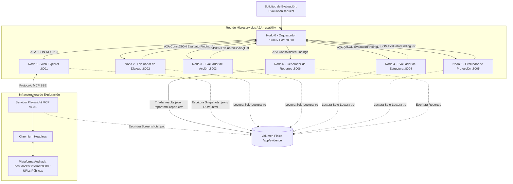

# Arquitectura del Sistema Multiagente Distribuido (DIMA-HE)

## 1. Identidad y Propósito del Sistema

El **Sistema Multiagente Distribuido para la Evaluación Heurística de Interfaces Web (DIMA-HE)** es una plataforma de software autónoma diseñada para auditar interfaces web aplicando de forma sistemática y reproducible las **10 heurísticas de usabilidad de Jakob Nielsen**.

Su diseño arquitectónico responde a la necesidad académica y práctica de evaluar rigurosamente plataformas complejas—inicialmente la plataforma web de la **Reserva de la Biosfera Tehuacán-Cuicatlán**—garantizando evidencia visual y estructural física, trazabilidad entre agentes, y separación estricta de responsabilidades entre exploración, análisis heurístico por dimensiones funcionales, consolidación determinista y reporte cuantitativo.

---

## 2. Topología de Red y Componentes

La arquitectura está conformada por **7 Nodos de Agentes A2A independientes**, un **Servicio de Infraestructura Playwright MCP** y un **Volumen Compartido de Evidencias** (`/app/evidence`).

---

## 3. Especificación Detallada de los Nodos

### 3.1. Nodo 0: Orquestador (`orchestrator`)
* **Puerto:** Interno `8000` | Host `8010`.
* **Tecnología:** Python 3.12 + Google ADK (`SequentialAgent`, `LoopAgent`, `ParallelAgent`, `BaseAgent`) + FastAPI.
* **Componentes Internos:**
  1. `exploration_loop` (`LoopAgent` con `max_iterations=3`): Sub-agentes `[remote_web_explorer, evidence_validator_agent]`.
  2. `evidence_validator_agent` (`BaseAgent` — Python puro): Implementa el patrón **`EscalationChecker`**. Inspecciona físicamente en `/app/evidence` que existan capturas `.png`, snapshots de accesibilidad `.json` y volcados DOM `.html` no vacíos. Emite `EventActions(escalate=True)` cuando la evidencia es válida; si falla, escribe retroalimentación en `exploration_feedback` para el siguiente reintento.
  3. `parallel_evaluators` (`ParallelAgent`): Dispara en paralelo las invocaciones A2A hacia los 4 evaluadores heurísticos (`remote_dialogue`, `remote_action`, `remote_structure`, `remote_protection`).
  4. `deduplicator_agent` (`BaseAgent` — Python puro): Agrupa problemas equivalentes basándose en página, heurística y selector, seleccionando la severidad máxima, fusionando evidencias y preservando la lista de agentes de origen (`source_agents`) e IDs de hallazgo originales (`original_finding_ids`).
  5. `root_agent` (`SequentialAgent`): Cadena principal que concatena determinísticamente:
     `[exploration_loop, parallel_evaluators, deduplicator_agent, remote_report_creator]`.

### 3.2. Nodo 1: Web Explorer (`web-explorer`)
* **Puerto:** `8001`.
* **Tecnología:** Python 3.12 + Google ADK + Playwright MCP (`McpToolset`) + FastAPI.
* **Responsabilidad:** Único nodo con conexión al navegador Chromium. Recibe el alcance (`EvaluationScope`), navega rutas autorizadas respetando la lista blanca anti-SSRF (`ALLOWED_TARGET_HOSTS`), captura la pantalla completa, extrae el árbol de accesibilidad semántico y vuelca el DOM físico.

### 3.3. Servicio Playwright MCP (`playwright-mcp`)
* **Puerto:** `8931` (Interno en la red Docker).
* **Imagen:** `mcr.microsoft.com/playwright/mcp:latest` ejecutando con `--no-sandbox`, `--browser chromium`, memoria compartida `shm_size: 1gb` y montando `/app/evidence`.

### 3.4. Nodos 2 al 5: Evaluadores Heurísticos
Desacoplados en microservicios independientes montando el volumen de evidencias en modo **solo lectura (`:ro`)**:
* **Nodo 2 (`evaluator-dialogue` - :8002):** Heurísticas H1 (Visibilidad del estado del sistema), H2 (Coincidencia entre sistema y mundo real), H10 (Ayuda y documentación).
* **Nodo 3 (`evaluator-action` - :8003):** Heurísticas H3 (Control y libertad del usuario), H7 (Flexibilidad y eficiencia de uso).
* **Nodo 4 (`evaluator-structure` - :8004):** Heurísticas H4 (Consistencia y estándares), H6 (Reconocimiento antes que recuerdo), H8 (Diseño estético y minimalista).
* **Nodo 5 (`evaluator-protection` - :8005):** Heurísticas H5 (Prevención de errores), H9 (Ayuda a reconocer y corregir errores).

Cada evaluador cuenta con **motor de inferencia dual**:
* **Inferencia Multimodal Gemini:** Inyecta directamente capturas `.png` físicas mediante `Part.from_bytes` junto con los fragmentos de árbol de accesibilidad y DOM estructurado.
* **Motor Determinista de Respaldo:** Analiza estructuras DOM y accesibilidad sin necesidad de conectividad a la API, garantizando operación continua en entornos CI/CD.

### 3.5. Nodo 6: Generador de Reportes (`report-creator`)
* **Puerto:** `8006`.
* **Tecnología:** Python 3.12 + FastAPI + csv/json estandarizado.
* **Responsabilidad:** Recibe el contrato `ConsolidatedFindings`, calcula distribuciones de severidad (0 a 4) y heurísticas (H1 a H10), genera un veredicto cualitativo y persiste la **tríada oficial de reportes** en `/app/evidence/evaluations/{evaluation_id}/reports/`:
  1. `results.json`: Estructura JSON completa para consumo programático.
  2. `report.md`: Resumen ejecutivo, tablas estadísticas y diagnóstico detallado para el documento de tesis.
  3. `report.csv`: Dataset tabular con formato RFC 4180 (`csv.QUOTE_ALL`) para análisis estadístico en hojas de cálculo.

---

## 4. Delimitación Estricta de Protocolos

| Protocolo | Ámbito de Aplicación | Implementación | Propósito |
| :--- | :--- | :--- | :--- |
| **Agent2Agent (A2A)** | Comunicación Inter-Agente | HTTP JSON-RPC 2.0 (`/.well-known/agent-card.json`, `/a2a/v1/message`) | Descubrimiento de capacidades y transmisión de contratos Pydantic v2 entre los 7 nodos. |
| **Model Context Protocol (MCP)** | Conexión Agente-Herramienta | SSE sobre HTTP (`http://playwright-mcp:8931/`) | Control de navegación, extracción de accesibilidad y capturas desde el Nodo 1 a Chromium. |

---

## 5. Modelo de Datos y Contratos de Intercambio

Los contratos residen en `shared/schemas/` y garantizan validación estricta con Pydantic v2:
* `EvaluationRequest`: Alcance, URL objetivo, instrucciones y resolución del viewport.
* `EvidenceItem`: Metadatos de archivos físicos (ruta relativa POSIX, tipo, tamaño en bytes; **prohibido Base64**).
* `ExplorationResult`: Agregación de páginas inspeccionadas, capturas y snapshots.
* `UsabilityFinding`: Diagnóstico heurístico individual emitido por un evaluador.
* `ConsolidatedFindings`: Resultado de la desduplicación determinista con trazabilidad de agentes e IDs originales.
